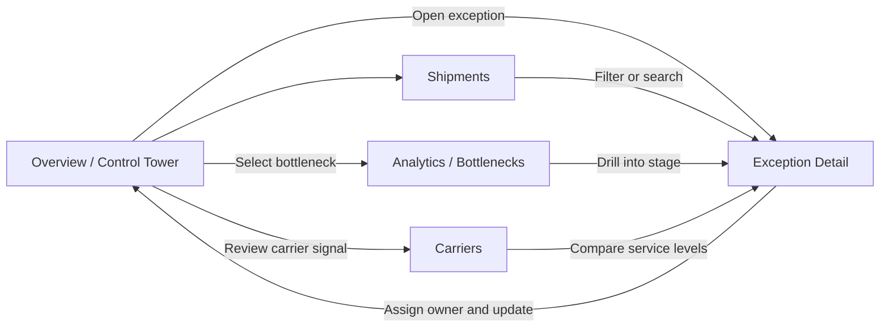

# Haulwise Mock UX

**Product purpose:** Give logistics operations teams one place to spot delivery bottlenecks, understand their impact, and resolve exceptions before customers are affected.

This document is the reviewable Mock UX for the MERN project. It focuses on user intent, navigation, screen hierarchy, and interaction states rather than production visual styling.

## Primary User

**Alex, Operations Lead** checks network health each morning, identifies the highest-impact delivery risks, assigns follow-up, and reports performance to the wider team.

## Navigation Flow



## Screen 01: Overview / Control Tower

**Job:** Understand network health in under 30 seconds.

```text
+--------------------------------------------------------------------------------+
| haulwise       Overview   Shipments   Exceptions   Carriers   Analytics        |
+--------------------------------------------------------------------------------+
| GOOD MORNING, ALEX                         [Last 30 days] [Export report]       |
| Here's what needs attention across the network.                                |
|                                                                                |
| [92.4% On-time] [1,284 In transit] [12 Exceptions] [2.8 days Avg transit]      |
|                                                                                |
| DELIVERY PERFORMANCE                  WHERE WORK GETS STUCK                      |
| On-time rate over time               Customs clearance       42%               |
| [bar chart + target line]             Last mile delivery      28%               |
|                                       Linehaul transit        18%               |
|                                                                                |
| EXCEPTIONS NEEDING ATTENTION                    [Search] [Filters]             |
| SHP-10482  Rotterdam -> Lyon   At risk   Customs   DHL Freight      18h       |
| SHP-10477  Hamburg -> Prague   Delayed   Linehaul  DB Schenker        9h       |
+--------------------------------------------------------------------------------+
```

**Primary actions:** Select an exception row, search shipments, choose a reporting range, export a report.

**Success state:** Alex knows the highest-risk stage and can open the first affected shipment without leaving the page.

## Screen 02: Exception Detail

**Job:** Turn a delivery risk into an owned action.

```text
+--------------------------------------------------------------------------------+
| <- Back to exceptions                                      [Mark resolved]     |
| SHP-10482  /  Northstar Retail                         STATUS: AT RISK         |
| Rotterdam -> Lyon       DHL Freight                    ETA: Today, 14:30       |
|                                                                                |
| IMPACT SUMMARY                          NEXT BEST ACTION                       |
| 18h delay risk                           Customs documents missing              |
| Customer priority: High                  [Assign to teammate v] [Add note]     |
|                                                                                |
| SHIPMENT TIMELINE                                                               |
| ✓ Picked up       ✓ Origin scan       ! Customs review       ○ Last mile        |
|   Sep 21             Sep 21              Delayed 18h          Pending           |
|                                                                                |
| ACTIVITY & NOTES                                                               |
| [Write an update...]                                      [Post update]        |
| Alex assigned customs follow-up to Priya                                 10:42 |
+--------------------------------------------------------------------------------+
```

**Primary actions:** Assign owner, add an operational note, mark resolved, return to exception list.

**Important interaction:** Resolving an exception updates the Overview count and removes it from the active queue.

## Screen 03: Analytics / Bottlenecks

**Job:** Find the process stage that will produce the greatest improvement.

```text
+--------------------------------------------------------------------------------+
| ANALYTICS                              [Last 30 days v] [Export]               |
|                                                                                |
| DELIVERY HEALTH        CUSTOMS DETAIL                                         |
| On-time rate 92.4%     Dwell time by country                                  |
| Avg transit 2.8 days   [horizontal bars: FR / DE / PL / IT]                    |
|                                                                                |
| BOTTLENECK CONTRIBUTION                                                       |
| Customs clearance  ████████████████████ 42%    [View shipments]               |
| Last mile delivery █████████████ 28%          [View shipments]               |
| Linehaul transit   ████████ 18%              [View shipments]               |
| Origin handling    █████ 12%                 [View shipments]               |
|                                                                                |
| INSIGHT: Reducing customs dwell by 0.5 days could lift on-time delivery ~4%.  |
+--------------------------------------------------------------------------------+
```

**Primary actions:** Change time range, inspect a stage, open the affected shipment cohort, export analysis.

## Screen 04: Carriers

**Job:** Compare carrier reliability and identify where a service review is needed.

```text
+--------------------------------------------------------------------------------+
| CARRIERS                                      [Search] [Region v] [Export]      |
|                                                                                |
| CARRIER              ON-TIME       AVG TRANSIT       ACTIVE       TREND         |
| DHL Freight          94.8%         2.4 days          382          +2.1%         |
| Kuehne+Nagel         93.6%         2.7 days          291          +0.8%         |
| Maersk               90.2%         3.1 days          248          -1.7%         |
| DB Schenker           88.9%         3.4 days          363          -3.2%         |
|                                                                                |
| Select a carrier to see lane-level performance, open exceptions, and notes.    |
+--------------------------------------------------------------------------------+
```

## Core User Journeys

### 1. Morning exception triage

1. Alex opens **Overview** and scans the four KPIs.
2. The **Exceptions needing attention** queue is already prioritized by customer impact and delay risk.
3. Alex searches a shipment ID or opens the highest-risk row.
4. In **Exception Detail**, Alex assigns an owner and posts the next action.
5. The exception count and activity feed update, preserving an audit trail.

### 2. Bottleneck investigation

1. Alex sees **Customs clearance** as the largest dwell-time contributor.
2. Alex opens **Analytics** and selects Customs.
3. The country and lane breakdown reveals where dwell is concentrated.
4. Alex opens the affected shipment cohort and assigns follow-up from the detail view.

### 3. Weekly carrier review

1. Alex opens **Carriers** and compares on-time rate, transit time, volume, and trend.
2. Alex selects a declining carrier to inspect lane-level exceptions.
3. Alex exports the comparison for the weekly operations review.

## UX Decisions To Validate

- Put exceptions and bottlenecks on the first screen because they lead directly to operational action.
- Use status labels and delay hours together so urgency is visible without opening detail.
- Keep the timeline and activity feed together in detail so decisions are explainable later.
- Make every analytical insight drillable into shipments, avoiding a dead-end reporting screen.
