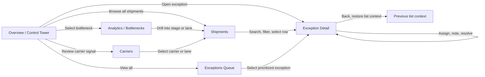

# Haulwise UX & User Flow Design

**Product purpose:** Give logistics operations teams one place to spot delivery bottlenecks, understand their impact, and resolve exceptions before customers are affected.

This document is the reviewable UX and user-flow design for the Haulwise logistics analytics product. It focuses on user intent, navigation, screen hierarchy, and interaction states rather than production visual styling. Screens and figures are illustrative; real data, permissions, and integrations must be confirmed before implementation.

## Primary User

**Alex, Operations Lead** checks network health each morning, identifies the highest-impact delivery risks, assigns follow-up, and reports performance to the wider team.

## Navigation Flow



**Global navigation:** Overview, Shipments, Exceptions, Carriers, and Analytics are persistent primary destinations. Settings and profile actions are secondary. The active destination is visibly highlighted, and detail pages provide a clear return path to the list or dashboard that opened them.

## Information Hierarchy and Interaction Rules

1. **Orient:** Show the page title, reporting range, and relevant workspace context.
2. **Scan:** Put network health KPIs and urgent exception counts before charts and tables.
3. **Investigate:** Keep filters and search near the result set they affect; show active filters and provide a clear reset action.
4. **Act:** Make the primary next action explicit on detail pages, with secondary actions visually quieter.
5. **Confirm:** Give visible feedback for assignments, notes, exports, and resolution; preserve a history of operational updates.

**Shared control behavior**

| Control | Expected behavior |
|---|---|
| Reporting range | Applies consistently to KPIs, charts, bottleneck analysis, and carrier comparisons; the selected range remains visible. |
| Search | Matches shipment ID, customer, route, and carrier; updates results as the user types and preserves the current filters. |
| Filters | Open a labelled filter panel, show selected values and the result count, and offer both Apply and Clear all. |
| Export | Exports the current view using its date range and filters; show progress, success, or a recoverable error. |
| Shipment row | Opens the matching shipment detail; keyboard users can reach and activate the same action. |
| Resolve | Requires confirmation, records who resolved the exception and when, and removes it from the active queue only after success. |

## Screen 01: Overview / Control Tower

**Job:** Understand network health in under 30 seconds.

```text
+--------------------------------------------------------------------------------+
| haulwise       Overview   Shipments   Exceptions   Carriers   Analytics        |
+--------------------------------------------------------------------------------+
| GOOD MORNING, ALEX                         [Last 30 days] [Export report]       |
| Here's what needs attention across the network.                                |
|                                                                                |
| [92.4% On-time] [1,284 In transit] [12 Exceptions] [2.8 days Avg transit]      |
|                                                                                |
| DELIVERY PERFORMANCE                  WHERE WORK GETS STUCK                      |
| On-time rate over time               Customs clearance       42%               |
| [bar chart + target line]             Last mile delivery      28%               |
|                                       Linehaul transit        18%               |
|                                                                                |
| EXCEPTIONS NEEDING ATTENTION                    [Search] [Filters]             |
| SHP-10482  Rotterdam -> Lyon   At risk   Customs   DHL Freight      18h       |
| SHP-10477  Hamburg -> Prague   Delayed   Linehaul  DB Schenker        9h       |
+--------------------------------------------------------------------------------+
```

**Primary actions:** Select an exception row, search shipments, choose a reporting range, export a report.

**Success state:** Alex knows the highest-risk stage and can open the first affected shipment without leaving the page.

**Screen states:** During loading, preserve the page structure and show placeholders for KPI and chart data. If there are no exceptions, replace the table with a calm empty state and a link to all shipments. If search or filters return no matches, explain that the current criteria found nothing and offer **Clear filters**. If data cannot be loaded, keep navigation available, explain that metrics may be stale, and provide **Retry**.

## Screen 02: Exception Detail

**Job:** Turn a delivery risk into an owned action.

```text
+--------------------------------------------------------------------------------+
| <- Back to exceptions                                      [Mark resolved]     |
| SHP-10482  /  Northstar Retail                         STATUS: AT RISK         |
| Rotterdam -> Lyon       DHL Freight                    ETA: Today, 14:30       |
|                                                                                |
| IMPACT SUMMARY                          NEXT BEST ACTION                       |
| 18h delay risk                           Customs documents missing              |
| Customer priority: High                  [Assign to teammate v] [Add note]     |
|                                                                                |
| SHIPMENT TIMELINE                                                               |
| ✓ Picked up       ✓ Origin scan       ! Customs review       ○ Last mile        |
|   Sep 21             Sep 21              Delayed 18h          Pending           |
|                                                                                |
| ACTIVITY & NOTES                                                               |
| [Write an update...]                                      [Post update]        |
| Alex assigned customs follow-up to Priya                                 10:42 |
+--------------------------------------------------------------------------------+
```

**Primary actions:** Assign owner, add an operational note, mark resolved, return to exception list.

**Important interaction:** Resolving an exception updates the Overview count and removes it from the active queue.

**Validation and feedback:** Require a selected owner before assignment. Do not clear an unsent note if posting fails. Confirm resolution before changing status; on failure, retain the exception and show a retry option. If the shipment is no longer available or the user lacks permission, show an explanatory state and a return-to-list action.

## Screen 03: Exceptions Queue

**Job:** Prioritize and work through delivery risks without losing their relative urgency.

```text
+--------------------------------------------------------------------------------+
| EXCEPTIONS                         [Search] [Status v] [Region v] [Owner v]     |
|                                                                                |
| 12 open   4 delayed   8 at risk                       [Sort: Customer impact v]|
| SHIPMENT       CUSTOMER          DELAY   STAGE       OWNER       NEXT ACTION    |
| SHP-10482      Northstar Retail  18h     Customs     Unassigned  Assign owner  |
| SHP-10477      Cedar & Co.        9h     Linehaul    Priya       View details  |
| ... 10 more prioritized exceptions                                           |
|                                                                                |
| Showing prioritized exceptions 1-12 of 12                                    |
+--------------------------------------------------------------------------------+
```

**Primary actions:** Search, filter by status/region/owner, sort by impact or delay, open a detail, and move between result pages. Keep resolved exceptions out of the default active queue while allowing users to include them through a status filter.

## Screen 04: Analytics / Bottlenecks

**Job:** Find the process stage that will produce the greatest improvement.

```text
+--------------------------------------------------------------------------------+
| ANALYTICS                              [Last 30 days v] [Export]               |
|                                                                                |
| DELIVERY HEALTH        CUSTOMS DETAIL                                         |
| On-time rate 92.4%     Dwell time by country                                  |
| Avg transit 2.8 days   [horizontal bars: FR / DE / PL / IT]                    |
|                                                                                |
| BOTTLENECK CONTRIBUTION                                                       |
| Customs clearance  ████████████████████ 42%    [View shipments]               |
| Last mile delivery █████████████ 28%          [View shipments]               |
| Linehaul transit   ████████ 18%              [View shipments]               |
| Origin handling    █████ 12%                 [View shipments]               |
|                                                                                |
| INSIGHT: Reducing customs dwell by 0.5 days could lift on-time delivery ~4%.  |
+--------------------------------------------------------------------------------+
```

**Primary actions:** Change time range, inspect a stage, open the affected shipment cohort, export analysis.

## Screen 05: Carriers

**Job:** Compare carrier reliability and identify where a service review is needed.

```text
+--------------------------------------------------------------------------------+
| CARRIERS                                      [Search] [Region v] [Export]      |
|                                                                                |
| CARRIER              ON-TIME       AVG TRANSIT       ACTIVE       TREND         |
| DHL Freight          94.8%         2.4 days          382          +2.1%         |
| Kuehne+Nagel         93.6%         2.7 days          291          +0.8%         |
| Maersk               90.2%         3.1 days          248          -1.7%         |
| DB Schenker           88.9%         3.4 days          363          -3.2%         |
|                                                                                |
| Select a carrier to see lane-level performance, open exceptions, and notes.    |
+--------------------------------------------------------------------------------+
```

**Primary actions:** Search or filter carriers, sort the comparison table, select a carrier to inspect its lanes and exceptions, and export the current comparison.

## Screen 06: Shipments

**Job:** Find a shipment using operational identifiers and narrow the network to a useful cohort.

```text
+--------------------------------------------------------------------------------+
| SHIPMENTS                                  [Search] [Status v] [Region v]       |
|                                                                                |
| Active filters: [In transit x] [Region: North x]                [Clear all]    |
| SHIPMENT       CUSTOMER         ROUTE           ETA          STATUS   CARRIER   |
| SHP-10482      Northstar Retail Rotterdam-Lyon  Today 14:30  At risk  DHL       |
|                                                                                |
| Showing 1-25 of 1,284                                      [Previous] [Next]   |
+--------------------------------------------------------------------------------+
```

**Primary actions:** Search, filter by status/region/carrier/date, sort columns, open a shipment, and page through results. Preserve filter and pagination context when returning from a shipment detail.

## Core User Journeys

### 1. Morning exception triage

1. Alex opens **Overview** and scans the four KPIs.
2. The **Exceptions needing attention** queue is already prioritized by customer impact and delay risk.
3. Alex searches a shipment ID or opens the highest-risk row.
4. In **Exception Detail**, Alex assigns an owner and posts the next action.
5. The exception count and activity feed update, preserving an audit trail.

The **Exceptions** navigation item opens the full queue when Alex needs to filter, sort, or review more than the highest-priority items.

### 2. Bottleneck investigation

1. Alex sees **Customs clearance** as the largest dwell-time contributor.
2. Alex opens **Analytics** and selects Customs.
3. The country and lane breakdown reveals where dwell is concentrated.
4. Alex opens the affected shipment cohort and assigns follow-up from the detail view.

### 3. Weekly carrier review

1. Alex opens **Carriers** and compares on-time rate, transit time, volume, and trend.
2. Alex selects a declining carrier to inspect lane-level exceptions.
3. Alex exports the comparison for the weekly operations review.

### 4. Shipment lookup

1. Alex opens **Shipments** and searches by shipment ID, customer, route, or carrier.
2. Alex narrows results with status or region filters and can see which filters are active.
3. Alex opens a result to inspect its timeline and exception actions.
4. Alex returns to the shipment list with the previous query and filters intact.

## Shared Loading, Empty, and Error States

- **Loading:** Use stable skeletons for cards, charts, and rows; keep page headings and navigation in place to avoid layout jumps.
- **Empty dataset:** Explain that no shipments or exceptions are available for the selected period and offer a way to broaden the date range.
- **No matching results:** Show the active search/filter context and a one-action clear/reset option.
- **Data-source error:** Identify the section that failed, show the last successful sync time when known, and provide a retry action. Do not present stale values as current.
- **Permission restriction:** Explain that access is restricted and direct the user to an authorized administrator; do not expose inaccessible shipment details.
- **Action failure:** Keep the user’s input and current context, explain which action failed, and offer a safe retry.

## Review Checklist

- Can an operations lead identify network health and urgent exceptions from the first screen without scrolling?
- Can a user reach shipment detail from Overview, Analytics, Carriers, and Shipments and return without losing context?
- Are search, filters, reporting range, export, and resolution behaviors explicit?
- Are loading, empty, no-results, permission, and error states represented?
- Does every chart or table support a clear operational question and a drill-down where relevant?
- Are important actions labelled, keyboard reachable, and accompanied by visible success or failure feedback?

## UX Decisions To Validate

- Put exceptions and bottlenecks on the first screen because they lead directly to operational action.
- Use status labels and delay hours together so urgency is visible without opening detail.
- Keep the timeline and activity feed together in detail so decisions are explainable later.
- Make every analytical insight drillable into shipments, avoiding a dead-end reporting screen.
- Confirm with operations users whether filters should apply immediately or require an explicit Apply action; this design uses Apply to avoid unexpected changes to large result sets.
- Validate the proposed carrier and shipment metrics, role permissions, and exception resolution policy with the product owner before implementation.
